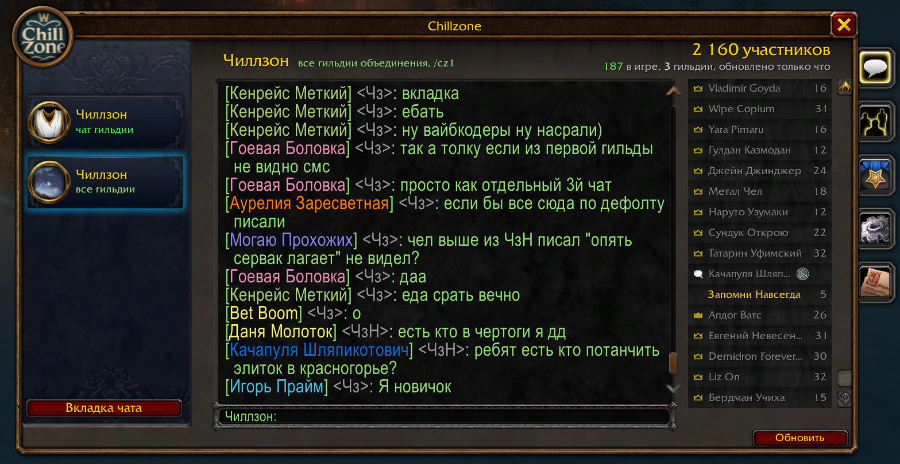
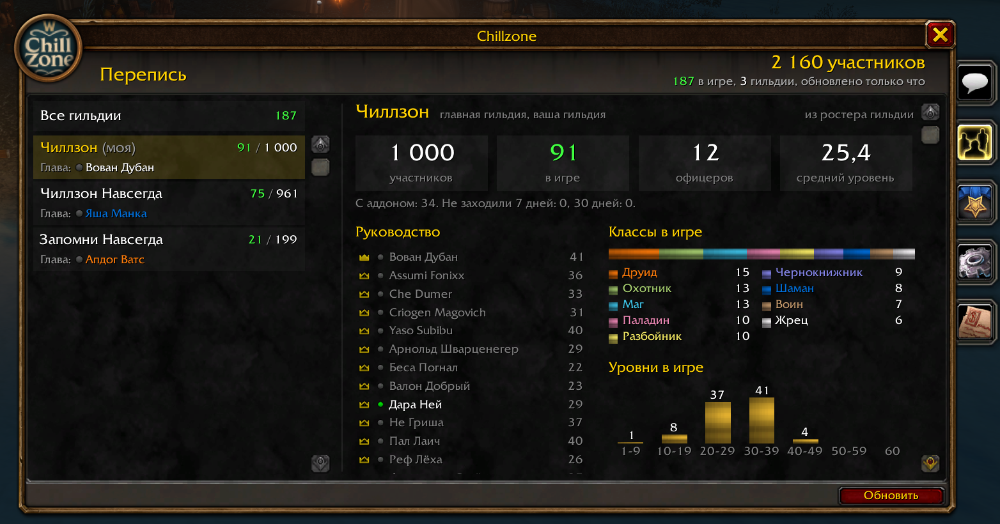

# Chillzone

[](https://github.com/FiNEk/Chillzone/actions/workflows/ci.yml)

Аддон для **WoW: Forever**. Связывает все гильдии, в названии которых есть «Чиллзон», и гильдию «Запомни Навсегда».

- **Общий чат** на три уровня: все участники, офицеры, главы.
- **Окно** в стиле «Гильдии и сообщества»: каналы, сообщения, люди в сети.
- **Перепись** гильдий: сколько участников, кто в игре, руководство, классы, уровни, зоны.
- **Королевство** и **круги на карте мира**.
- **Вступление:** поиск гильдий через `/who`, просьба офицеру гильдии, общая очередь офицеров на вкладке «Заявки».



<p>


</p>

## Установка

1. Скачайте `Chillzone-<версия>.zip` из [последнего релиза](https://github.com/FiNEk/Chillzone/releases/latest).
2. Распакуйте папку `Chillzone` в `World of Warcraft\_forever_\Interface\AddOns\`.
3. Перезапустите игру и проверьте: `/chillzone status`.

Когда у других игроков уже стоит более новая версия, аддон просит обновиться: строкой в чате и в заголовке окна. Это работает с версии, вышедшей после 0.8.0.

## Команды

| Команда | Что делает |
|---|---|
| `/chillzone` | открыть или закрыть окно Chillzone |
| `/cz1 текст`, `/cz2 текст`, `/cz3 текст` | написать всем / офицерам / главам |
| `/cz текст` | написать всем, включая текст со словами команд |
| `/чз текст`, `/чз1 текст`, `/чз2 текст`, `/чз3 текст`, `/чиллзон текст` | те же команды на кириллице; `/чиллзон` = `/cz` |
| `/chillzone diag` | вкладка «Отладка»: реле, перепись, счётчики, ошибки (главы и офицеры) |
| `/chillzone help` | все команды |
| `/chillzone nocontact on\|off` | отключить или включить обращения о вступлении на вашем аккаунте |
| `/chillzone requests` | вкладка «Заявки»: очередь вступления в вашу гильдию (главы и офицеры) |

Текст после `/cz` набирается в обычном игровом поле и отправляется по Enter, без открытия окна аддона. Команда без текста показывает подсказку.

Кнопка у миникарты открывает окно, а при наведении показывает сводку:


Перепись и чат идут через участников главной гильдии. Главы и офицеры имеют приоритет; если они недоступны, релеем и репортёром может стать обычный подтверждённый участник. Автор подписывает сообщение один раз, получатели проверяют его локально: подтверждать каждое сообщение личным шёпотом не нужно. Релей не может изменить подписанный текст или автора.

В версии 0.4 ключи создаются автоматически внутри игры. В каждой гильдии офицер один раз выполняет `/chillzone trust init`: его ключ становится корнем доверия гильдии. Для первого соединения офицер своей гильдии выполняет `/chillzone link Имя Фамилия`, указывая известного офицера главной гильдии. Получатель проверяет имя и гильдию вне запроса и подтверждает `/chillzone accept Имя Фамилия`. Дальше доверие сохраняется, резервные реле находятся автоматически. Списка надёжных персонажей в коде нет.

Все стороны должны обновиться до 0.4: старый неподписанный протокол отключён. Подписи защищают авторство, но не скрывают текст от релеев и участников. Генерация случайности внутри игры повторяет подход Olympus и не имеет гарантий системного криптогенератора. Сроки сертификатов, восстановление после утраты ключа и другие границы описаны в [модели безопасности](docs/SECURITY.md).

Как всё устроено, ограничения и чек-лист проверки в игре описаны в [docs/DETAILS.md](docs/DETAILS.md).

Персонажу вне гильдий Чиллзона `/chillzone` показывает экран вступления. «Найти гильдии» запускает обычный игровой `/who`; поиск можно повторять через 10 секунд, чтобы пройти диапазоны уровней при лимите 50 результатов. Под названием гильдии видны её офицеры в игре: их подсказывают участники гильдии с аддоном. Просьба уходит только офицеру, её можно отредактировать перед отправкой. Если ответа нет, следующий щелчок выберет другого офицера. Вступление из другой гильдии остаётся разговором с офицером: аддон сам не выводит персонажа из его гильдии.

Вкладка **«Заявки»** видна только главам и офицерам гильдий Чиллзона, даже если заявок пока нет. Это значок без подписи, количество заявок — в подсказке при наведении; открыть её можно и командой `/chillzone requests`. На вкладке — общая очередь своей гильдии, включая просьбы, пришедшие рядовым. Любой офицер с игровым правом приглашать может принять или отклонить заявку; результат передаётся остальным. «Закрыть для всех» убирает заявку из общей очереди без ответа новичку. У рядового вкладки нет: полученная им просьба автоматически уходит офицерам.

Число заявок и срок их обработки не ограничены, весь список можно прокручивать. Очередь хранится в памяти: после входа или `/reload` офицер получает её у участников, у которых она ещё сохранилась. Если все держатели вышли или перезагрузили интерфейс, очередь теряется. Отключить личные обращения можно в настройках или командой `/chillzone nocontact on`; это не отключает общую очередь офицера. Для обмена общей очередью нужны обновлённые версии у адресата просьбы и у офицеров. Текст письма передаёт обновлённый отправитель; у новичка со старой версией офицеры увидят имя, уровень и класс, а его шёпот останется только у первоначального адресата. Обычная личная переписка в общую очередь не копируется.

## Разработка

```bash
luajit tests/run.lua
lua5.1 tests/run.lua
luacheck .
```

Для обычного Lua 5.1 нужна библиотека LuaBitOp (`lua-bitop` в Ubuntu); в игровом клиенте `bit` уже встроен. CI проверяет обе версии интерпретатора.

То же самое CI запускает на каждый PR и пуш в `main`. Как выпустить версию — в [docs/DETAILS.md](docs/DETAILS.md#выпуск-версии).

## Лицензия

MIT, см. [LICENSE](LICENSE). Часть кода портирована из [Olympus](https://github.com/dnl-gentile/olympus-addon) (MIT), подробности в [THIRD_PARTY.md](THIRD_PARTY.md).
